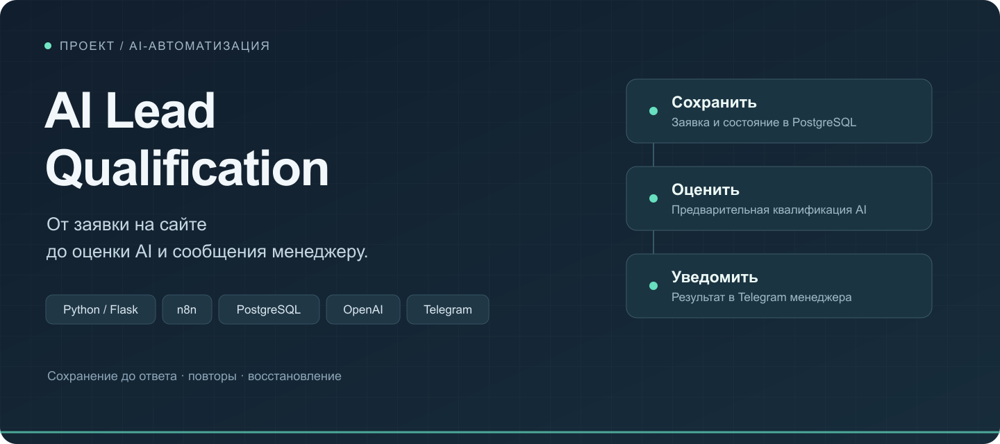

# AI Lead Qualification

**Приём и AI-квалификация заявок на автоматизацию бизнеса.**

Клиент описывает задачу в форме. Система проверяет данные, сохраняет заявку и передаёт её в фоновую обработку. Менеджер получает в Telegram исходный запрос, оценку AI, срочность и короткое объяснение.

Основной акцент проекта — надёжная обработка заявки: подтверждение после сохранения, защита от повторной отправки и восстановление после сбоев внешних сервисов.

**Статус:** портфолио-проект с проверенной рабочей цепочкой. Проверки от 16 октября 2026 года выполнены на локальном Flask, n8n Cloud и Supabase. Репозиторий содержит обезличенные исходники и экспорты; постоянное публичное размещение не входит в текущую версию.

[Краткий кейс](docs/case-study.md) · [Архитектура](docs/architecture.md) · [Запуск и настройка](docs/setup.md) · [Результаты проверок](docs/verification.md)

## Какую задачу решает

Входящие обращения различаются по качеству: в одном подробно описана задача и указаны сроки, в другом нужна дополнительная информация. Менеджеру приходится читать каждое сообщение и самостоятельно выделять главное.

Здесь заявка поступает в едином формате, сохраняется вместе с состоянием обработки и дополняется предварительной квалификацией. AI помогает расставить приоритеты; решение о дальнейшей работе остаётся за человеком. Реальная экономия времени и влияние на продажи в проекте не измерялись.

## Как проходит заявка

1. **Форма и Flask** проверяют контакт, описание, бюджет, направление, сроки и согласие на обработку данных.
2. **n8n Intake** повторно проверяет входящие поля и вызывает PostgreSQL-функцию `enqueue_lead_v1`.
3. **PostgreSQL** сохраняет новую заявку либо определяет повтор или конфликт. Только подтверждённый приём возвращается пользователю как HTTP 202.
4. **n8n Worker** получает задание, запрашивает OpenAI и сохраняет результат. Оценка от 70 отмечается как приоритетная; остальные заявки тоже сохраняются и передаются менеджеру.
5. **Telegram** получает карточку заявки. Доставка учитывается отдельно от выполнения AI.
6. **Recovery** раз в пять минут подбирает доступные задания, если немедленный запуск пропущен или подошло время повтора.

Пользователь формы видит подтверждение приёма. Результат AI предназначен менеджеру в Telegram; просмотр результата на сайте в этой версии не реализован.

## Что умеет

| Возможность | Реализация |
|---|---|
| Структурированный приём | Имя, Telegram / email / российский телефон, направление, бюджет, описание и сроки |
| Неизвестный бюджет | Передаётся как `null`; инструкция AI предписывает не снижать балл только по этой причине |
| Квалификация AI | Оценка 0–100, намерение, срочность, объяснение до 160 символов |
| Повторная отправка | Один `request_id` и те же нормализованные данные — повтор без второй записи |
| Конфликт отправки | Тот же `request_id` с другими данными — HTTP 409 |
| Ошибки AI | Отложенные повторы; при постоянной ошибке или исчерпании попыток — ручная проверка |
| Ошибки Telegram | Отдельные попытки и статус доставки, без повторного AI-анализа уже сохранённого результата |
| Восстановление | Просроченное владение заданием можно получить заново; старый обработчик не может перезаписать результат |

## Почему такая архитектура

- **Python остаётся небольшим сервисом.** Он обслуживает форму, проверяет контракт и передаёт запрос в n8n. Прямого подключения Flask к базе нет.
- **Интеграции находятся в n8n.** Intake, Worker и Recovery разделены по назначению, их можно настраивать независимо.
- **Состояние хранится в PostgreSQL.** Ответ AI, доставка, число попыток и время следующего запуска переживают отдельное выполнение workflow.
- **Успех означает сохранение.** Медленный AI не задерживает HTTP-ответ формы. HTTP 202 не означает, что Telegram уже доставлен.

Подробности блокировок, токенов обработки и компромиссов — в [описании архитектуры](docs/architecture.md).

## Что проверено

| Проверка | Объём |
|---|---:|
| Локальные Python-тесты | 26 |
| Сценарии нормализации и валидации Intake | 51 |
| Сценарии выбора исхода AI | 7 |
| Интеграционные проверки PostgreSQL | 9 |
| Полный маршрут с OpenAI и Telegram | 1 вымышленная заявка |

Проверены конкурентная отправка одного UUID, повтор, конфликт, ограничения владения заданием, отложенные попытки и подбор нескольких заданий. Отдельно проверены структура workflow и JavaScript Code-узлы.

**Измерения не сводятся к одной цифре «скорости».** Первый успешный приём новой заявки занял 2,32 с. Медиана отдельной серии из восьми повторов уже обработанной заявки — 0,38 с. Условия различаются; эти результаты не доказывают ускорение новой заявки до 0,38 с и не являются SLA. Методика и границы — в [отчёте о проверках](docs/verification.md).

## Границы текущей версии

- AI выдаёт рекомендацию: система не проверяет существование контакта, платёжеспособность или достоверность описания и не отклоняет заявку по оценке.
- `request_id` защищает от повтора конкретной отправки, а не объединяет все обращения одного клиента.
- Повтор Telegram возможен, если сервис принял сообщение, но подтверждение потерялось. Гарантия единственной доставки не заявляется.
- Recovery ограничен пятью вызовами Worker и общим таймаутом. Это небольшая очередь без подтверждённой пропускной способности под нагрузкой.
- Для публичной эксплуатации нужны постоянный запуск, HTTPS, ограничение частоты запросов, резервные копии и наблюдение за ошибками. Реальные сетевые обрывы и длительная нагрузка ещё не проверены.

## Навигация по репозиторию

| Файлы | Назначение |
|---|---|
| [app.py](app.py), [validation.py](validation.py), [serve.py](serve.py) | HTTP-маршрут, правила проверки данных, локальный запуск через Waitress |
| [static/index.html](static/index.html) | Форма заявки |
| [n8n/intake.json](n8n/intake.json) | Приём, проверка, сохранение и запуск Worker |
| [n8n/worker.json](n8n/worker.json) | AI, повторы, ручная проверка и Telegram |
| [n8n/recovery.json](n8n/recovery.json) | Периодический подбор заданий |
| [db/README.md](db/README.md) | Порядок подготовки базы и ограничения SQL-файлов |
| [tests](tests) | Локальные проверки контракта, ответов и workflow |

В репозитории нет рабочих ключей, адресатов Telegram и реальных заявок. Экспорты выключены, связи и credentials требуют настройки. Для воспроизведения используйте [инструкцию запуска](docs/setup.md).
