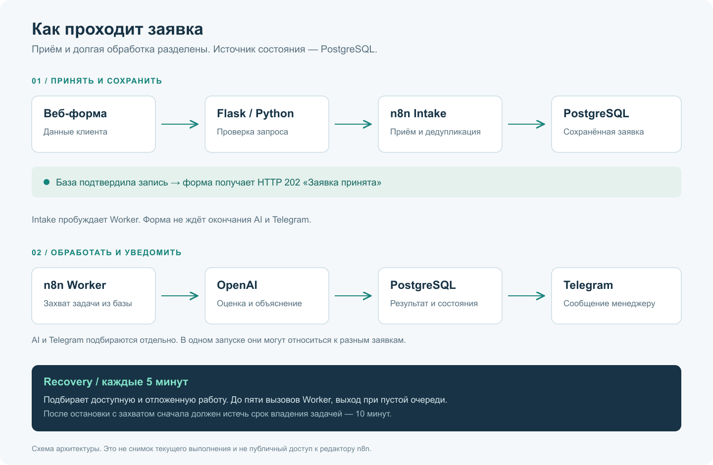

# Кейс: приём и AI-квалификация заявок

[Репозиторий](../README.md) · [Архитектура](architecture.md) · [Проверки](verification.md)

**Формат:** портфолио-проект, проверенный на вымышленных данных. Реальный заказчик и бизнес-результаты не заявляются.

## Задача

Собрать обращения на автоматизацию бизнеса в одном формате и передавать менеджеру заявку с предварительной оценкой. Приём должен подтверждаться после сохранения, а задержка AI или ошибка Telegram не должны требовать повторного ручного ввода исходных данных.

## Решение

Форма передаёт данные во Flask. После проверки n8n Intake сохраняет заявку в PostgreSQL и возвращает подтверждение. Отдельный Worker запрашивает OpenAI и отправляет менеджеру карточку в Telegram: описание задачи, контакт, бюджет, сроки, оценку, намерение и краткое объяснение.

Использованы Python / Flask / Waitress, n8n, PostgreSQL / Supabase, OpenAI и Telegram Bot API. Python обслуживает входящий HTTP-запрос; n8n управляет интеграциями; база хранит состояние обработки.

## Ключевые решения

**Сохранение перед подтверждением.** HTTP 202 означает, что заявка принята и сохранена. Он не обещает завершения AI и доставки Telegram.

**Повтор как нормальный сценарий.** После таймаута пользователь может отправить те же данные с тем же идентификатором. База вернёт существующую заявку; другие данные под этим идентификатором дадут конфликт.

**Раздельный учёт AI и доставки.** Для каждого этапа учитываются попытки и время следующего запуска. Ошибка Telegram не заставляет заново анализировать готовую заявку.

**Восстановление незавершённой работы.** Задание выдаётся на ограниченный срок. Токен защищает запись результата от позднего ответа старого запуска, а Recovery подбирает доступные задания по расписанию.

**AI помогает менеджеру.** Ответ ограничен схемой из четырёх полей. Низкий балл не удаляет заявку, а ошибки анализа переводят её к ручной проверке. Неизвестный бюджет не считается нулевым.

## Подтверждённый результат

На 16 октября 2026 года прошли 26 Python-тестов, 51 сценарий Intake, 7 сценариев исхода AI и 9 интеграционных проверок PostgreSQL. Один контролируемый прогон прошёл полностью: форма → база → AI → Telegram. Повторы этой заявки не создали новую запись и не увеличили число отправок Telegram.

Проверки включали конкурентный приём одного UUID, защиту от старого токена, отложенные повторы и восстановление просроченной задачи. Методика и ограничения — в [отчёте](verification.md).

Первый успешный HTTP-приём новой заявки занял 2,32 с. В отдельной серии повторов уже обработанной заявки медиана составила 0,38 с. Это разные сценарии; второй результат не выдаётся за время первого приёма.

В ходе работы Intake был упрощён на основе уже существовавшей PERF-версии: объединены нормализация, валидация и подготовка данных. Flask переиспользует HTTP-соединения по потокам. Вклад каждого изменения в задержку отдельным сопоставимым экспериментом не измерялся.

## Границы

Получена работающая цепочка с исходниками, обезличенными workflow, SQL и проверками. Исходная заявка и её состояние сохраняются независимо от отдельного внешнего запроса.

Постоянное размещение, длительная нагрузка и реальные сетевые обрывы ещё не проверены. Повтор Telegram при потере подтверждения остаётся возможным. Экономия времени менеджера, рост продаж и окупаемость не измерялись.

Для внедрения следующий шаг — выбрать среду, настроить сопровождение, проверить отказные сценарии и оценить полезность AI на обращениях конкретного клиента.
